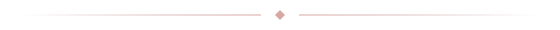

<em>If only the snow could fall slower...</em>

A Discord theme inspired by Liquid Glass. Soft acrylic, liquid glass, and a look you can make your own.

  
  
  

<h2>The theme</h2>

Choose acrylic or liquid glass, then adjust the blur, colors, and tints. Add your own wallpapers, change avatar size and roundness, and choose a vertical or horizontal server list.

<h2>The app</h2>

Hotori is a Windows installer and customizer in one app. Install or remove the theme, preview wallpapers, and save each category separately.

<strong>Update theme</strong> brings in the latest theme while keeping your saved settings. <strong>Reset to defaults</strong> gives you a fresh start whenever you want.

<h2>Get started</h2>

<strong>1.</strong> Install <a href="https://vencord.dev/download/">Vencord</a> for Discord.

<strong>2.</strong> Download <code>hotori.exe</code> from <a href="https://github.com/tsukidan/hotori/releases">Releases</a> and click <strong>Install</strong>.

<strong>3.</strong> Enable Hotori in <strong>Vencord → Themes</strong>, then open <strong>Customize</strong>.

Windows · Vencord required · Only the EXE is needed

Made by <a href="https://github.com/tsukidan">tsuki</a> · <a href="docs/development.md">Development notes</a>

